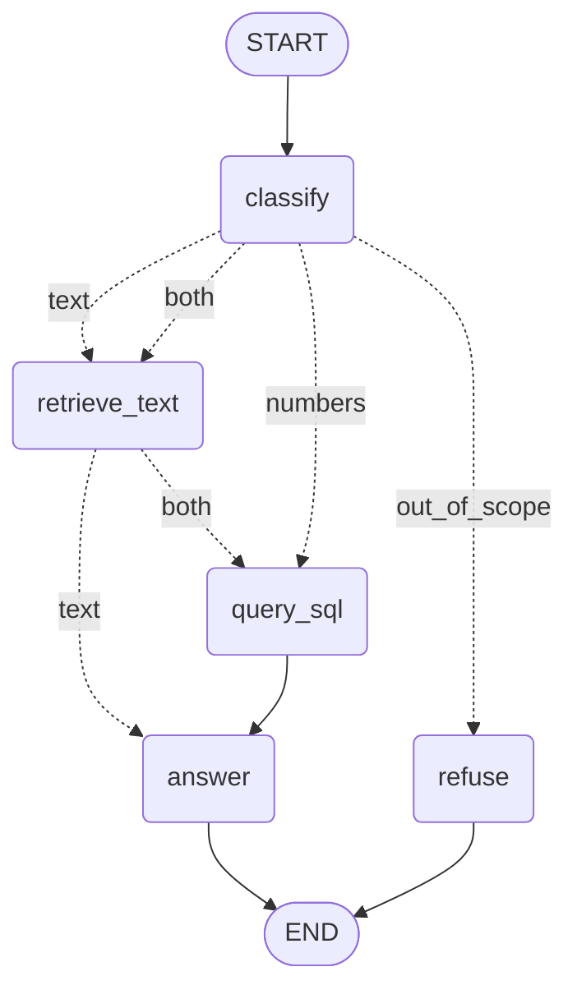
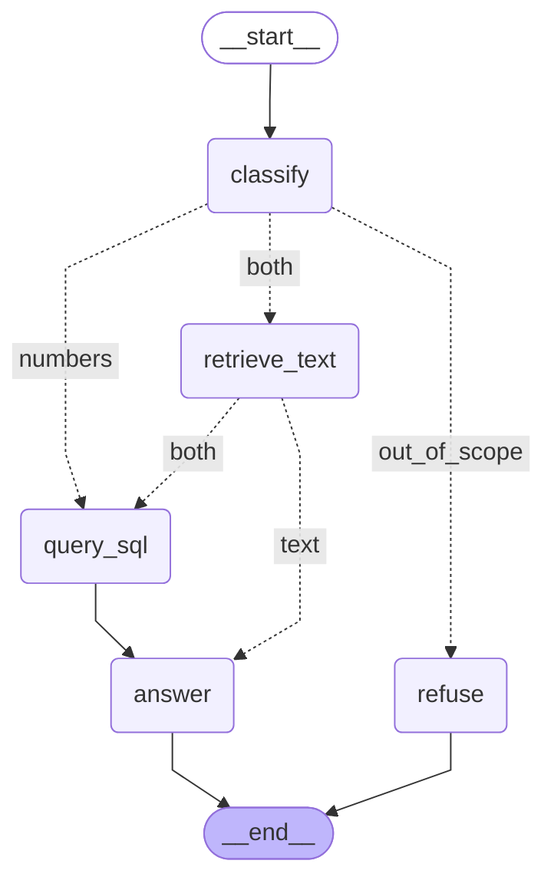

# Agent graph design

Planned LangGraph graph for the Financial Analyst Agent (design of 25 Nov). The
compiled graph is under "Compiled graph" below. Solid arrows are fixed edges, dashed
arrows are conditional edges, and each dashed label is the route name the
classifier returns.

Rendered image (for viewers without Mermaid support): [agent_graph.png](agent_graph.png).
Regenerate it after changing the diagram with
`mmdc -i docs/agent_graph.md -o docs/agent_graph.png` (the output file gets a `-1` suffix; rename it).

Routes: `text`, `numbers`, `both`, `out_of_scope`. The classifier must return these
exact strings. `retrieve_text` has a conditional edge too: it goes to `query_sql`
only when `route == "both"`, otherwise to `answer`.

## Planned state

| Field | Meaning |
|---|---|
| `question` | The user's question, as asked. |
| `route` | One of `text`, `numbers`, `both`, `out_of_scope`, set by `classify`. |
| `route_reason` | One sentence from `classify` on why it chose the route, for debugging and evaluation. |
| `sources` | Cited 10-K chunks (company, year, section) from `retrieve_text`; empty if none. |
| `sql` | The DuckDB query `query_sql` ran (after validation and any repair). |
| `rows` | Rows returned by that query; empty on error or no match. |
| `answer` | Final text written by `answer` or `refuse`. |
| `error` | Tool failure message (RAG or SQL), or `None`; `answer` must report it, not hide it. |

## Node to code mapping

The graph is built in `src/financial_analyst_agent/agent/graph.py` (`build_graph()`
compiles it once). The state is `AgentState` in
`src/financial_analyst_agent/agent/state.py` (`TypedDict`, `total=False`, the fields above).

| Node | Code | Status |
|---|---|---|
| `classify` | `src/financial_analyst_agent/agent/classifier.py`: `classify(state)` returns `route` and `route_reason`; `RouteDecision` and `ROUTES` in `src/financial_analyst_agent/agent/schemas.py` | Done (26 Nov, structured output with `json_schema`) |
| `retrieve_text` | `src/financial_analyst_agent/agent/tools.py`: `retrieve_text(state)` uses the RAG chain's `default_retriever` (hybrid search + rerank, k=5) and writes `sources` (company, year, section, source file, text). It only retrieves; it does not answer | Done (27 Nov) |
| `query_sql` | `src/financial_analyst_agent/agent/tools.py`: `query_sql(state)` calls `sql/tool.py` `answer_with_sql(question)` unchanged and writes `sql`, `rows` and `error` | Done (27 Nov) |
| `answer` | `src/financial_analyst_agent/agent/answer.py`: `answer(state)` makes one model call with the 10-K excerpts and/or SQL rows. Rules: the RAG chain's strict `SYSTEM_RULES` unchanged, plus citing sources and US dollar units. Ends with a `Sources:` block built in code. With no context (or only an error) it returns a fixed message without calling the model | Done (27 Nov) |
| `refuse` | `src/financial_analyst_agent/agent/graph.py`: `refuse(state)` returns the fixed `REFUSE_MESSAGE` | **Provisional until 30 Nov** (fixed short message; the real node is built that day) |

All model calls use the local Ollama model through
`src/financial_analyst_agent/llm.py` (`get_llm`). End-to-end check:
`poetry run python scripts/try_agent_graph.py`.

## Compiled graph

Generated on 27 Nov with `build_graph().get_graph().draw_mermaid()`. The edges out of
`retrieve_text` use the route names as keys (`RETRIEVE_TARGETS`), so they carry the
same `text` and `both` labels as the design:

Differences from the design above (drawing only; the behaviour matches the design
and is tested in `tests/test_agent_graph.py`):

- `classify → retrieve_text` shows only the `both` label. The `text` and `both`
  routes go to the same node, and the drawing keeps one label per pair of nodes. This
  is a limit of LangGraph's drawing, not of the graph.
- `START`/`END` are drawn as `__start__`/`__end__`.

## Design notes

- **Investment advice is out of scope.** Questions such as "Should I buy JPM stock?"
  are classified as `out_of_scope` and go to `refuse`. The agent reports what the
  10-K filings say; it does not recommend buying or selling.
- **Tool failures reach `answer` with the error.** If `retrieve_text` or `query_sql`
  fails (for example, the SQL is rejected as unsafe or still fails after retries),
  the node writes the message to `error` and the graph continues to `answer`, which
  says the figure could not be retrieved. The agent never fills the gap with made-up
  numbers.
